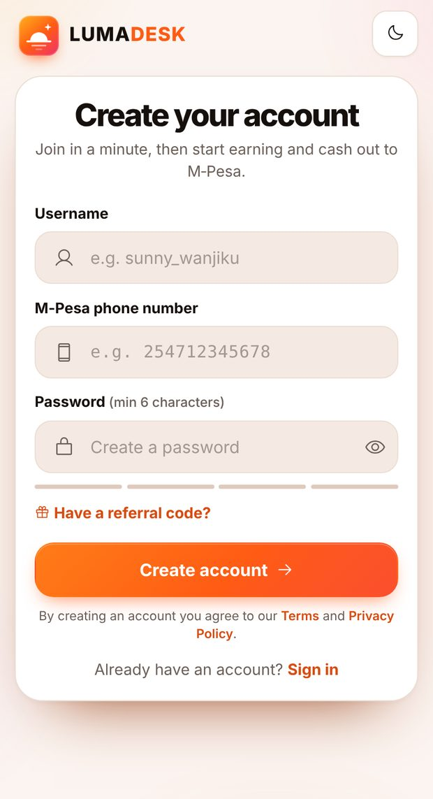
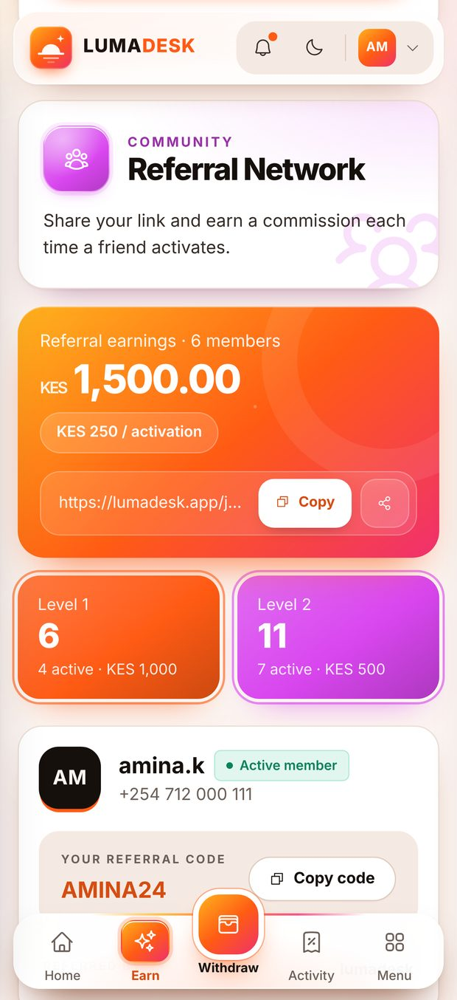
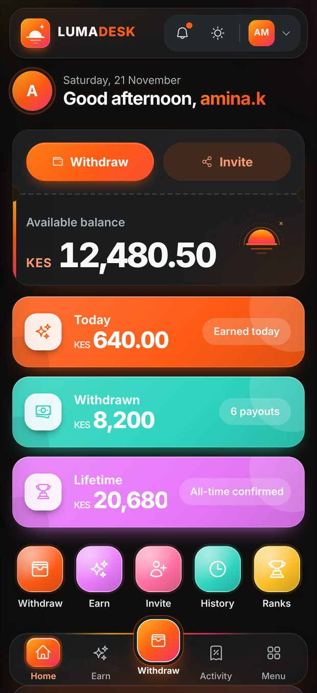

# Sunrise UI Kit v4

A premium, theme-driven dashboard design system. Clean white cards with high-contrast text, gradient stat cards,
Heroicons (plus 4 switchable icon libraries), payment bottom sheets, task cards, cash-out forms, responsive tables,
pagination, light and dark mode, and a **Theme Studio** where an admin changes the whole colour scheme live.
No framework, no build step: 4 files.

| Login | Register | Home | Cash out | Pay sheet | Referrals | Dark |
|---|---|---|---|---|---|---|
|  |  |  |  |  |  |  |


## Quick start
Open `demo/login.html` (or `demo/dashboard.html`) in a browser (sidebar → Admin → Theme studio to recolour).

```html
<head>
  <meta name="viewport" content="width=device-width, initial-scale=1, viewport-fit=cover">
  <link rel="stylesheet" href="https://fonts.googleapis.com/css2?family=Inter:wght@400;500;600;700&family=Sora:wght@500;600;700;800&family=JetBrains+Mono:wght@400;500&display=swap">
  <link rel="stylesheet" href="https://unpkg.com/@phosphor-icons/web@2.1.1/src/regular/style.css">
  <link rel="stylesheet" href="kit/sunrise.css">
  <script>window.SR_THEME = { preset: "ember", icons: "heroicons" };</script>
  <script src="kit/sunrise-theme.js"></script>
</head>
<body>
  … shell from demo/dashboard.html …
  <script src="kit/sunrise-icons.js"></script>
  <script src="kit/sunrise-ui.js"></script>
</body>
```
Change colours without JS: `:root{--brand:#2563eb;--brand-2:#38bdf8;--brand-3:#7c3aed}`.
Presets: `ember`, `ocean`, `emerald`, `royal`, `rose`, `cobalt`, `gold`, `graphite`.
Icon libraries: `heroicons` (default), `fluent`, `lucide`, `tabler`, `fontawesome`.

## What's inside
| Path | What |
|---|---|
| `kit/` | `sunrise.css` (design system), `sunrise-theme.js` (themes, dark mode, admin config), `sunrise-icons.js` (5 icon libraries, inline SVG), `sunrise-ui.js` (ripple, sheets, tabs, pagination, toasts, Theme Studio) |
| `demo/` | `login.html`, `register.html`, `forgot.html`, `dashboard.html`, `transactions.html` (cash out + pagination), `pages.html` (lessons, tasks, referrals, account) |
| `SKILL.md` | Full rules: responsive, icons, motion, components, mobile patterns, backend theme saving, checklist |
| `AGENTS.md` | Instructions any AI coding tool should follow (also `CLAUDE.md`, `GEMINI.md`, `.cursor/rules`, `.windsurfrules`, `.github/copilot-instructions.md`) |
| `skills/sunrise-dashboard-ui/` | The same rules packaged as a Claude skill |
| `tools/` | `build-icons.py` + `icon_map.py` to add icons or trim the bundle |
| `screenshots/` | Mobile and desktop previews |

## Using it with AI tools
Paste the repo link and say what to build, e.g.
*"Using https://github.com/YOU/sunrise-ui-kit, build my loans admin panel with users, payments and settings pages."*
Tools that read repo instruction files (Claude Code, Cursor, Copilot, Windsurf, Gemini CLI, Codex) pick up the rules automatically.

## License
MIT for the kit. Bundled icons keep their own licenses — see `THIRD_PARTY_NOTICES.md`.
