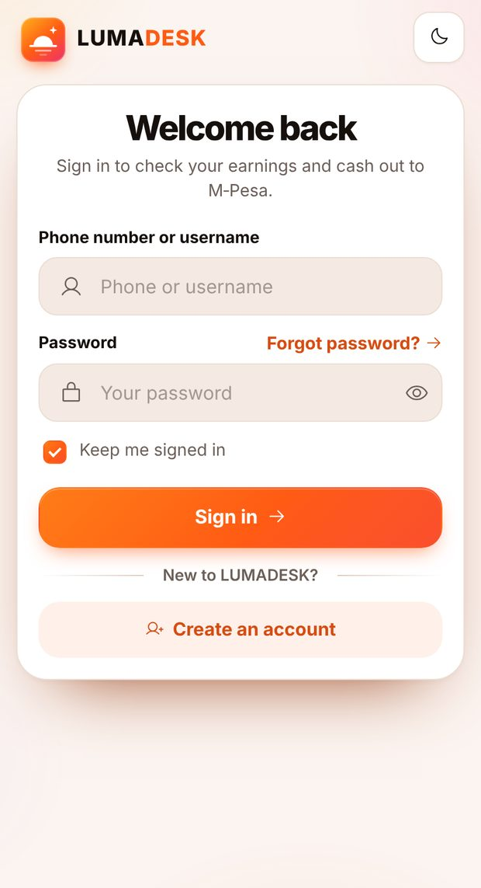
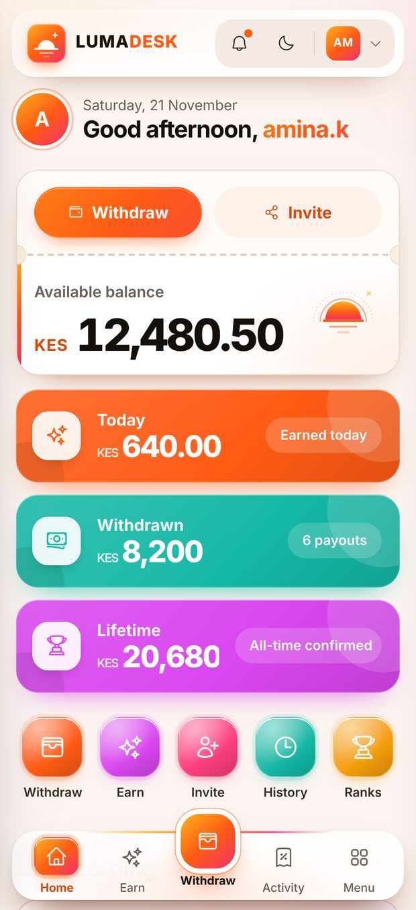
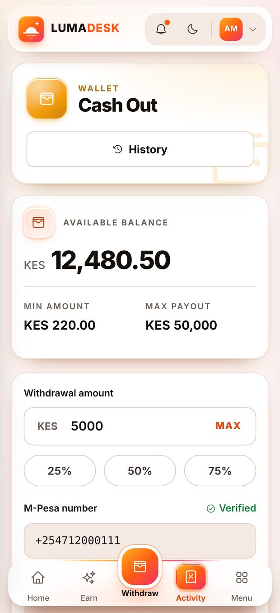
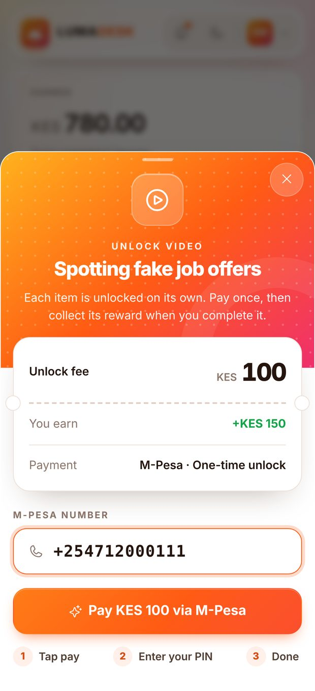
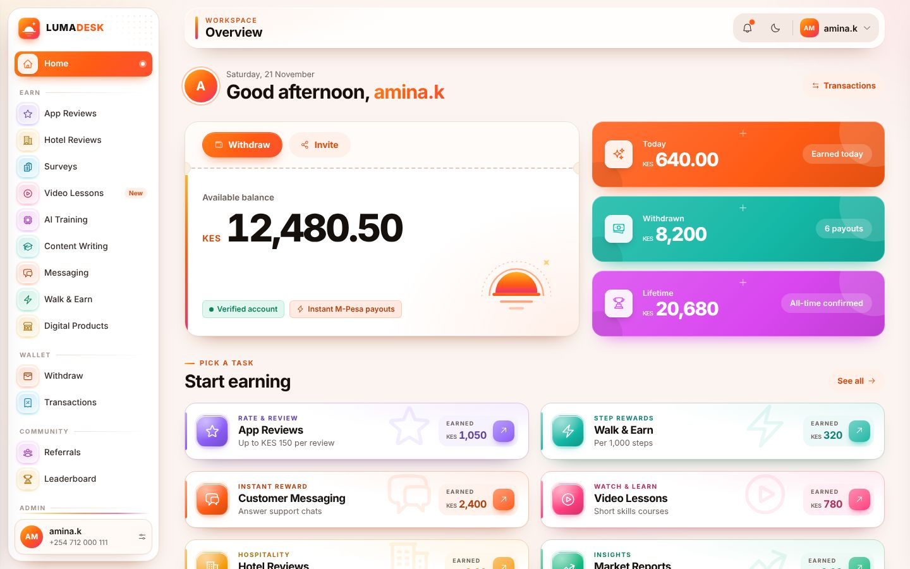
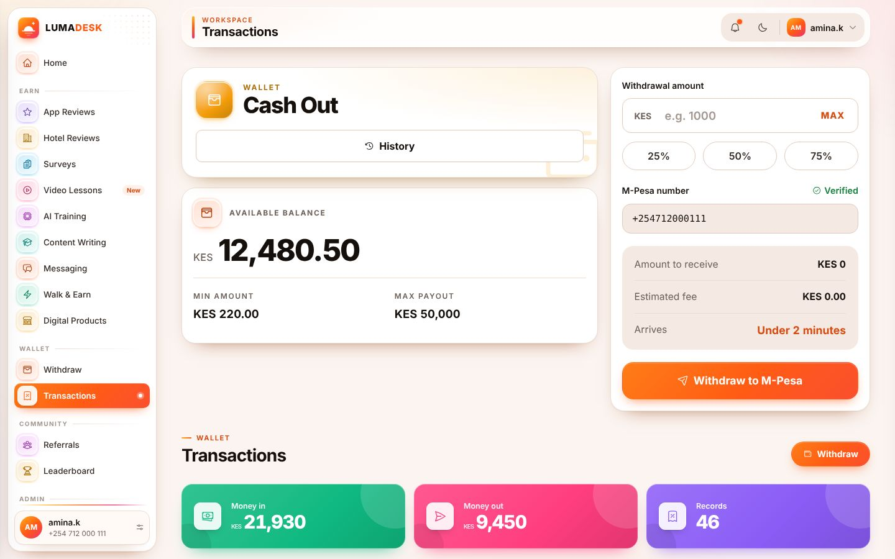
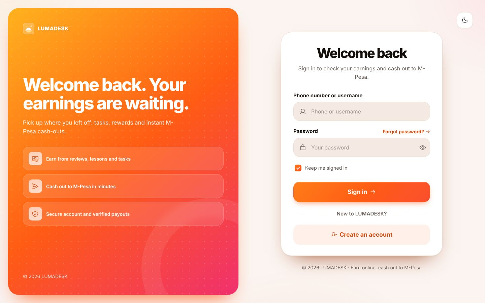
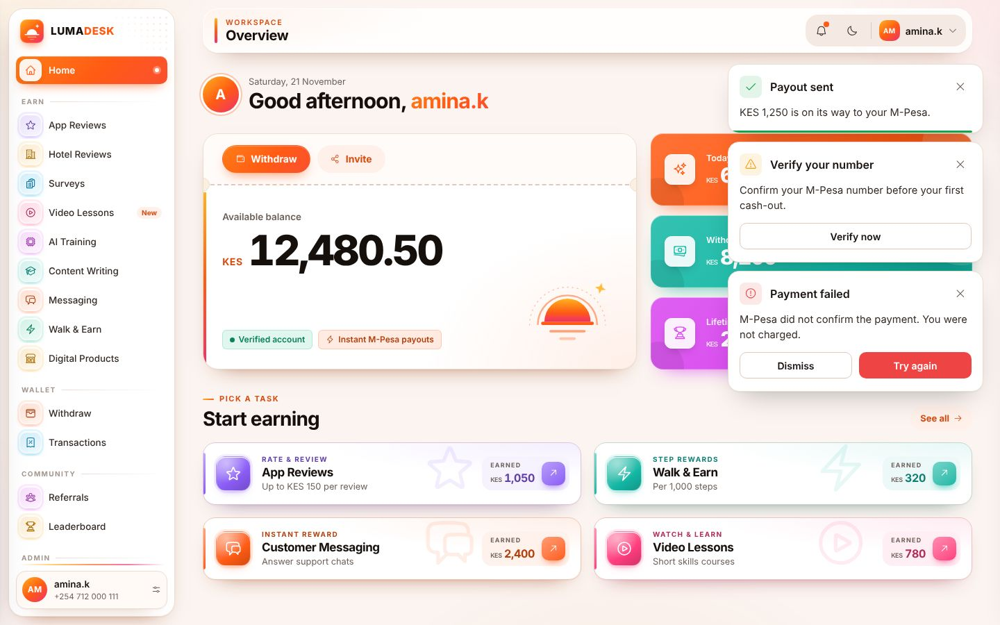

# Sunrise UI Kit v7

A premium, theme-driven dashboard design system. Clean white cards with high-contrast text, gradient stat cards,
Heroicons (plus 4 switchable icon libraries), payment bottom sheets, task cards, cash-out forms, responsive tables,
pagination, light and dark mode, and a **Theme Studio** where an admin changes the whole colour scheme live.
No framework, no build step: 4 files.

| Login | Register | Home | Cash out | Pay sheet | Referrals | Dark |
|---|---|---|---|---|---|---|
|  |  |  |  |  |  |  |






## What's new in v7
- **Rules that every AI tool follows.** `RULES.md` is the single source; `tools/sync-rules` writes AGENTS.md, CLAUDE.md, GEMINI.md, Cursor, Copilot, Windsurf and Cline files.
- **One command runs every test: `tools/check-all`.** It runs as a pre-commit hook (`tools/install-hooks`) and in GitHub Actions.
- **PHP + MySQL backend kit** in `backend/`. It is cPanel-ready, with clean URLs, automatic migrations and secure defaults, plus optional modules: jobs, M-Pesa stages, documents, partners, chat with AI, PWA and push. Start with [backend/README.md](backend/README.md).

## Quick start
Serve the repo (`python3 -m http.server 8765`) and open `http://127.0.0.1:8765/demo/login.html`. The demos use a strict CSP, so open them over HTTP rather than as files. `demo/components.html` shows the v6 components and the dark theme picker.

**Check any page for layout bugs:** add `?sr-debug` to its URL. Anything wider than the screen is outlined red.
**Full QA (one command):** `python3 tools/qa_all.py --base http://127.0.0.1:8765/demo/ --pages dashboard.html,components.html --public login.html --login-url login.html --user demo --password demo --themes all` checks overflow, real text contrast, gradient buttons, console errors, CSP violations and login, at 360/412/1280 px in light, dark and all 10 dark themes. See SKILL.md §11.

```html
<head>
  <meta name="viewport" content="width=device-width, initial-scale=1, viewport-fit=cover">
  <meta name="sr-theme" content='{"preset":"ember","icons":"heroicons","dark":{"theme":"ocean","useAccent":true}}'>
  <link rel="stylesheet" href="kit/sunrise-fonts.css">
  <link rel="stylesheet" href="kit/vendor/phosphor/phosphor.css">
  <link rel="stylesheet" href="kit/sunrise.css">
  <script src="kit/sunrise-theme.js"></script>
</head>
<body>
  … shell from demo/dashboard.html …
  <script src="kit/sunrise-icons.js"></script>
  <script src="kit/sunrise-ui.js"></script>
</body>
```
Change colours without JS: `:root{--brand:#2563eb;--brand-2:#38bdf8;--brand-3:#7c3aed}`.
Presets: `ember`, `ocean`, `emerald`, `royal`, `rose`, `cobalt`, `gold`, `graphite`.
Icon libraries: `heroicons` (default), `fluent`, `lucide`, `tabler`, `fontawesome`.

## What's inside
| Path | What |
|---|---|
| `kit/` | `sunrise.css` (design system), `sunrise-theme.js` (themes, dark mode, admin config), `sunrise-icons.js` (5 icon libraries, inline SVG), `sunrise-ui.js` (ripple, sheets, tabs, pagination, toasts, Theme Studio) |
| `demo/` | `login.html`, `register.html`, `forgot.html`, `dashboard.html`, `transactions.html` (cash out + pagination), `pages.html` (lessons, tasks, referrals, account), `admin.html` (admin panel: stat strips, modules, page heads with buttons, metrics), `public.html` (logged-out header, search, filters, Yes/No pills, upload, step form), `status.html` (M-Pesa / status-check page with simulator), `loading.html` (preloader, progress bar, skeletons, busy card, loading/empty/error/offline states), `components.html` (v6: promo carousel, dark theme picker, searchable select, multi-step form with error summary, upload compression, bulk select). Page code lives in `demo/js/` (CSP-safe). |
| `SKILL.md` | Full rules: responsive, icons, motion, components, mobile patterns, backend theme saving, checklist |
| `AGENTS.md` | Instructions any AI coding tool should follow (also `CLAUDE.md`, `GEMINI.md`, `.cursor/rules`, `.windsurfrules`, `.github/copilot-instructions.md`) |
| `skills/sunrise-dashboard-ui/` | The same rules packaged as a Claude skill |
| `tools/` | `qa_all.py` (full QA: overflow, contrast, errors, CSP, login), `qa.py`, `dw_measure.py`, `sync-rules` (regenerate AI entry files from RULES.md), `build-icons.py` + `icon_map.py` to add icons or trim the bundle |
| `screenshots/` | Mobile and desktop previews |

## Using it with AI tools
Paste the repo link and say what to build, e.g.
*"Using https://github.com/YOU/sunrise-ui-kit, build my loans admin panel with users, payments and settings pages."*
Tools that read repo instruction files (Claude Code, Cursor, Copilot, Windsurf, Gemini CLI, Codex) pick up the rules automatically.

## License
MIT for the kit. Bundled icons keep their own licenses — see `THIRD_PARTY_NOTICES.md`.
